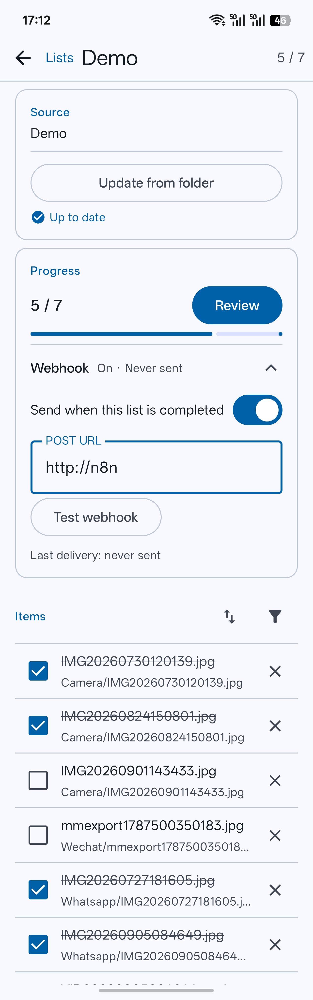

# Core concepts

The vocabulary Listea uses, and the one rule that explains most of its behaviour.

- [Folders you grant](#folders-you-grant)
- [Upstreams](#upstreams)
- [Tasks and Todos](#tasks-and-todos)
- [Deleting a Todo](#deleting-a-todo)
- [Folders](#folders)
- [Files and items](#files-and-items)
- [Lists](#lists)
- [Folder types](#folder-types)
- [Quick Review](#quick-review)
- [Rounds and queues](#rounds-and-queues)
- [Checked state](#checked-state)
- [Actions](#actions)
- [Where state lives](#where-state-lives)
- [Item identity](#item-identity)

## Folders you grant

Listea reaches nothing it has not been given. Access comes from Android's system folder picker, one
grant per folder, and **each grant is held on its own**: adding a second folder does not cost you
the first. A grant is a Storage Access Framework tree URI, and it persists across restarts.

A grant covers the folder you picked and nothing else. Listea cannot reach outside it — not into a
sibling folder, not into a parent — and taking the grant away in Android's settings makes that
folder unavailable rather than deleting anything Listea knows.

Earlier versions had a single **root**, the one folder everything was scoped to. Lists built then
still record it and still work; nothing you add now is tied to it.

## Upstreams

An **Upstream** is a folder that has come into the system. Outside Listea it is only a folder — a
*Source*, in the sense of a file that exists whether or not anyone has chosen it — and what makes it
an Upstream is someone picking it.

Adding one is a **Settings** action, because it is about what Listea may read rather than about what
there is to do. The **Upstreams** tab lists one card per Upstream, and opening a card browses that
folder live.

An Upstream is not a queue and holds nothing to review. It has no Tasks of its own, no Quick Review
and no selection; the two things to do with one are looking at it and running **Create Tasks**
somewhere inside it. It is not tied to any one Todo either — you may run several imports over
different folders within it, or none at all.

An Upstream is **available** while Listea still holds the grant its folder sits under. One whose
grant is gone stays on the list rather than disappearing: the Tasks it produced still exist, a List
built from them still works, and what is lost is refreshing and browsing it.

## Tasks and Todos

A **Task** is one unit of work. Running **Create Tasks** over a folder inside an Upstream makes them:

| Importer | What a Task is |
|---|---|
| **One Task per file** | One Task per file in the folder. Its folder tree can be kept or flattened |
| **One Task per folder** | One Task per immediate child folder, holding that folder's files. Flat by construction |

A **Todo** is what one run produced: those Tasks, plus the provenance saying which folder they came
out of and under which importer. Opening a Todo shows them — as a browsable tree of folders when the
run kept the folder tree, and as one flat list when it did not.

**A Todo is not "everything the Upstream holds".** A run happens on the folder you were in when you
asked for it, so one Upstream can carry several Todos over different parts of its tree, and a folder
that has never been imported has none. What a Todo holds is exactly what its one run made, which is
why its card is a thing in its own right rather than a view of the Upstream.

**They may overlap, and a folder may have as many Todos as you have intentions for it.** A run over
a folder nested inside a Todo you already made is allowed, and so is running the same folder twice.
What a run makes is a *new* set of Tasks: they belong to the Todo that ran, and the fact that the
same files are behind another Todo's Tasks is not a relationship between them.

That is the rule the whole model turns on. A **Task** is the user's intention, so the same file
reached through two Todos is two Tasks with two decisions, and the same Task reached through two
Lists is one Task with one. The file itself is never owned: it is content *presented for* a Task,
and presenting it for a second one takes nothing away from the first — see [Lists](#lists).

Creating a Todo on a folder that already has one is therefore ordinary, and the dialog says so
rather than asking permission: it names the Todos already there, then proceeds.

### What a changed Task means

A file in a Todo's folder can change without Listea doing anything: it is deleted in the Files app, or
it is moved, or new files are added beside the ones a run imported. The next run over that folder
finds a Task whose content is not what the run left there, and every Todo has to answer what that
means. The answer is a **content policy**, chosen per Todo, and there are three:

| Policy | The Task | Its decisions | Lists holding it |
|---|---|---|---|
| **Keep it** | survives | survive | keep it |
| **Start it over** | survives, same Task | cleared | keep it |
| **Replace the Task** | deleted, a new one minted | go with the Task | lose it, and are told |

**Keep it** is the default and the answer that changes nothing: material that has gone is flagged
missing, and the Task, its ticks and every List holding it are untouched.

**Start it over** keeps the Task's identity — so its history, its List memberships and every id a
webhook would carry are unchanged — and clears its *decisions*. A Task whose content moved is not
the same thing to judge, so carrying the old tick forward is the mistake this tier exists to avoid.

**Replace the Task** is the only tier that reaches lifetime, and it is the only one that removes
anything. The Task is deleted and a fresh one is minted by the same run, at the same path, so a
replacement exists exactly when the run has material to put in it: a group whose files have all gone
is replaced by nothing.

**Two things stop a policy from becoming a machine that acts on everything.** First, a Task the run
finds *unchanged* is under no policy at all — all three describe what a change means, so a run that
finds the material as it left it has nothing to answer, and a Todo under *Start it over* does not
clear its Tasks' decisions every time it is refreshed. Material already flagged missing counts as
unchanged for the same reason. Second, a **refresh only looks at what it scanned**: a partial
re-import of one folder says nothing about the Assets a Task holds outside it, and their absence
from the plan is not a disappearance.

### Task lifetime

**A Task's lifetime never depends on how many Assets it has.** A folder-as-Task Task over a folder
that empties, and is later given a file, is still the same Task; deleting a Task because its count
reached zero would make that return impossible. No policy reads a Task's *size* — all three read a
change to the set.

**Nothing in Listea replaces a Task it decided about on its own.** A program that deleted a Task
because it noticed something about the Task's structure would be deriving a lifetime from structure,
which the architecture forbids. The only way a Task is replaced is a user having said *replace the
Tasks that change* for that Todo: the difference is who said it, and that is the whole of the tier's
licence.

One consequence is not an exception to the rule but the same rule applied: **asking to replace a Task
that holds a single file starts it over instead.** Replacing it would mint a Task holding that same
one file under a new id, with its decisions and its List memberships gone — loss with nothing bought.
The policy still decides *that* something happens; the Task's own shape only decides which of two
ways of honouring it is available.

## Deleting a Todo

Deleting a Todo is **a dissolution**: deleting an intention is abandoning what it meant, so the
Tasks go with it, and so do their decisions. Lists that held those Tasks keep their titles, their
order and their webhooks, and lose the memberships — a List is an order over Tasks, and an order
nothing satisfies is empty rather than gone. Each List that lost rows says so, and when.

What does not go is the file's own identity. A file deleted and re-imported is the same file to the
wire, still carrying the checked state Quick Review and the browser show it under. Only the
*judgments made by the Tasks that went* are abandoned.

**A deletion can leave a record behind, and you choose whether it does.** *Keep the decisions* in the
confirmation writes down what each Task was judged to be before it goes — including, for a Task
nobody had judged, the fact that nobody had. That record is called a **history**, and it belongs to
the folder the intention was made at rather than to the files.

A Todo **created** at that folder is then offered the histories left there, newest first, and may
load **one** of them. Loading is a copy rather than a resurrection: the new Todo's Tasks take on the
judgments recorded for the paths they hold, and nothing about the old Tasks comes back — so a file
the new run did not produce has nothing to receive. Paths are the whole of the match, which
means a history written by one grouping rule and loaded into another recovers nothing at all.

**The note a List leaves says which of the two took its rows.** A deletion and a *Replace the
Task* policy both shorten a List, and a List that reported the wrong cause would be describing an
operation that never happened — so the reason is stored beside the count and the time, and the
sentence is written from it: *"3 items removed when a Todo was deleted"* against *"3 items removed
when their content moved"*. Unlike the count and the time, the reason is **not** cleared when the
List moves on: nothing reads it unless a count is standing next to it.

Two things follow from that, and both are visible:

- **Loading a history does not consume it.** A later Todo at the same folder is offered it again.
  What a history says is *these were the judgments once*, and more than one dish knowing that is
  correct.
- **A refresh is never offered one.** A refresh runs over a Todo that is still here, and loading a
  history there would overwrite the decisions made since with older ones.

## Folders

Folders are browsed, not imported. The **Upstreams** tab opens an Upstream's folder and walks its
tree live, reading whatever is on disk at the moment you look.

Listea does not modify anything it browses. Nothing is moved, renamed or created. The only writes
to storage happen through three explicit actions — see [File management](file-management.md).

## Files and items

A **file** is what is on disk. An **item** is a file as it appears in a queue: a title, a path, and
whatever has been decided about it.

- **A folder is not an item by default.** Under one-Task-per-file, only files become Tasks. Under
  one-Task-per-folder a single Task stands for a whole folder, and a swipe walks the files inside
  it before moving on — see [Tasks and Todos](#tasks-and-todos).
- A List may still hold **manual items** — typed by hand, with no file behind them. They are no
  longer something you can add: a List built before v0.2 may have them, and they go on working
  exactly as they did, reviewable and editable, until their own List's lifecycle removes them. They
  behave differently in one specific way, noted under [Where state lives](#where-state-lives).

## Lists

A **List** is a persistent queue, made from **Tasks you pick**.

Open a Todo and tap **Select**. The catalog becomes a selection surface; tick the Tasks to include —
a folder's box takes the whole folder — and tap **Create List** in the bar along the bottom. The
dialog names the List and lists exactly the Tasks it will hold. See
[Review and actions](review-and-actions.md) for the selection rules.

Selecting is reached from inside a Todo rather than from the Todo tab, because the tab's rows are
Todos and a row cannot say which of its Tasks you meant. The Tasks themselves are the only things
that can.

A List made this way has **no folder behind it**. It holds the Tasks you chose and nothing else, so
there is no disk for it to drift from and no **Source** card on its detail page — its items, its
progress and its webhook are the whole of it.

**Lists made from a folder** — the ones v0.2.x built by scanning a folder — still work exactly as
they did, and they are the only ones with a Source card. That card reports whether the folder has
changed since the List was built, and **Update from folder** reconciles the two: showing exactly what
was added and what went missing, and applying it only on confirmation. Files that vanished stay in
the List, flagged, keeping their checked state, until you clear them.

**Overlap was a rule about folder-backed Lists.** One such List's folder could not contain
another's, so creating one where an existing List already reached asked for confirmation first.
Create List now builds from Tasks you pick, and Tasks have no folder to overlap with, so that
question no longer arises.

There is still no "New list" control, and no way to make an empty List and fill it in by hand: a
List is made from Tasks, and a List with no Tasks has nothing to hold. Lists from earlier versions
are kept as they are, with their items, and are never converted, migrated or deleted.

<p align="center">
  
</p>

## Folder types

Every folder in the browser shows its relationship to a List:

| Type | Meaning |
|---|---|
| **None** | No List covers this folder. |
| **List** | This exact folder owns a List. |
| **Sublist** | An ancestor folder's List already covers this folder's files. |

A **Sublist** folder shows the progress of *its own subtree*, not the owning List's overall total —
but the webhook shown alongside it belongs to the owning List, because that is whose webhook it is.

This type is **about Lists only**. It says nothing about whether a folder's material has been turned
into Tasks, and a Todo exists whatever its Upstream's relationship to a List.

## Quick Review

**Quick Review** is a review over the Tasks **directly in one folder of a Todo**, with no List
involved. It creates nothing, replaces nothing and consults no List.

It appears once the folder you are looking at has Tasks in it, and it reviews those:

- **It never recurses.** A round covers the Tasks at this level, not the ones nested below it. What
  a run produced is a tree, and the tree is how you say which part of it you mean; a round that
  swept in everything underneath would make the folder you chose meaningless. To review a
  subfolder's Tasks, open that subfolder and start a round there.
- **It is not offered where there are no Tasks**, which includes the Todo's own top level when the
  run kept the folder tree: there, as in a browsed folder, the only things in front of you are
  folders.
- It always starts at the first unchecked item.
- It never remembers where it got to.

A Todo holds nothing but Tasks, so unlike a browsed folder there is no listing to reconcile against
the catalog: what is reviewed is exactly what the run put there.

**A Todo round has no folder behind it**, which has one visible consequence on the wire: its items
carry no public id and nothing on this path sends a webhook. Decisions are still saved, and are
still visible everywhere else, because of [where state lives](#where-state-lives).

Quick Review can be switched off in Settings. Off takes the action out of a Todo and stops the
Upstreams browser drawing what has already been decided. Switching it off is presentation only:
Lists keep their items, completion and actions.

## Rounds and queues

A **queue** is the ordered set of items one review walks. A **round** is one pass through a queue,
from opening the review to leaving it.

Two things decide a queue, composed as an AND:

1. **The page's filter and sort** — the subset you picked out before pressing Review, from the
   folder's *Files* header or the List's *Items* header.
2. **Review unchecked items only** — the standing setting, which only ever removes.

Asking for *Checked* on the page while the setting says unchecked-only yields nothing at all, and
that is the honest answer rather than a reason for either to win.

**The queue is fixed when the review opens.** It is a snapshot, not a live filter: an item you
check stays in front of you and stays swipeable backwards, instead of vanishing under your thumb
and renumbering everything. Leaving and re-entering starts the next round.

**The membership is fixed; the decisions are not.** Which items a round walks is a snapshot — what
has been decided *about* them is read live. Checking or tagging an item shows up on the spot: in the
round you are in, in another round open on the same Task, and on the List's row behind it. The two
were one value once: a round resolved its items on entry and never re-read them, so a tap wrote to
the database and drew nothing back.

Two consequences worth knowing:

- An item added to the List mid-round joins the *next* round, not this one.
- Narrowing changes what is *reviewed* and nothing else. Progress, completion and webhook
  behaviour always count the whole List or the whole folder. A hundred-item List filtered down to
  fifty and reviewed to the end reads *fifty of a hundred*, never *fifty of fifty*.

See [Review and actions](review-and-actions.md#filtering-and-sorting) for the filter and sort
options themselves.

## Checked state

**Checked** means "I have dealt with this in Listea". It is a completion flag and nothing more — it
does not say what you decided, and it does not imply any action.

A file is checked by swiping left in a review, by the checkbox in the review bar, or from a List's
item row.

## Actions

An **action** is a tag you put on an item to say what should happen to it downstream.

- **★ Favourite** is built in.
- **Custom actions** are yours: any number of them, each with a **display name** (what you see on
  the chip) and a **webhook value** (what the payload sends). Two are configured out of the box.

Actions and checked state are independent. Tapping a chip does not check an item; checking an item
does not tag it. Neither implies the other, on screen or on the wire.

An item stores the *id* of each action it carries, never the display name or wire value. That is
what makes renaming an action free: future payloads change, no stored item is touched, and nothing
already marked is reinterpreted. Removing an action takes it off the bar and leaves the items that
carry it alone — invisible and unsent, but not rewritten.

## Where state lives

> **This section predates v0.2.5 and is being revised.** The rule it states — a decision belongs to
> the file — still describes what the user sees, but not where the row lives. Imported material is
> now a **Task** (one file, or a folder's worth of them under the folder-as-Task importer), and a
> decision is stored against the Task: `task_state`, keyed by `taskId`, cascading from `tasks`.
> The columns that once held it on the review-state and list-item tables are dead. The consequences
> listed below all still hold, because a folder-as-Task Task keeps its own state as one unit.

This one rule explains most of Listea's behaviour. Checked, ★ and whichever custom actions an item
carries are stored against the file's identity — the root it is under, plus its path beneath that
root — in a table of their own. A List stores **membership**: which files it covers, in what order.
It *projects* the shared state rather than owning a copy.

That is what makes all of these true at once:

- Quick Review needs no List, because it has somewhere to put a decision either way.
- Checking a file in a Quick Review completes the List that covers it, and fires that List's
  webhook, without Quick Review knowing the List exists.
- Building a second List over the same files shows the same ticks. Nothing is copied, so nothing
  can diverge.
- Deleting a List discards its membership, not its decisions. Rebuilding it brings them back.
- Deleting a **Todo** does take its Tasks' decisions, because a Task is the intention and the
  decision is what the intention meant — see [Deleting a Todo](#deleting-a-todo). That is the one
  operation here that discards state rather than projecting it, which is why it is behind a
  confirmation and why the confirmation offers to write the decisions down first.
- The Upstreams browser can show a file as checked even when no List has ever heard of it.
- Nothing resets state as a side effect. Creating a List or opening a Quick Review never clears a
  tick. Re-reviewing checked files is what *Review unchecked items only* is for, and a genuine
  "start fresh" would have to be its own explicit action.

**Manual items are the exception, deliberately.** They have no file behind them, so there is no
other row for a decision about one to be shared with: it belongs to that item alone, and it goes
when the item does.

A file's identity is **its path under the root**. Replacing a file with a different one of the same
name, outside the app, hands the new file the old one's checked state.

## Item identity

Every item carries a 24-character **public id**, assigned when the row is created and never changed
afterwards. It is what goes onto the webhook, and it is safe to use as a primary key on the
receiving side.

```
0AT9K3QWMB-4H7ZP2-XC5N0V
└────┬───┘ └──┬─┘ └──┬─┘
   time     file    random
```

- **time** — milliseconds since the epoch, base32, fixed width. Sorting the ids **as strings**
  sorts them by when the item arrived; no parsing needed.
- **file** — a fingerprint of what the row is about: a file's path under the root, or a manual
  item's List and title. Deterministic, so two arrivals of the same file share this field. A hint
  for grouping, not a guarantee.
- **random** — 30 bits, and what actually makes the id unique.

The alphabet is Crockford base32 — no `I`, `L`, `O` or `U` — so an id copied out of a log by hand
cannot be misread.

**An id names one *arrival* of a file, not the file itself.** The same file entering Listea again —
a new List over the same folder, a re-sync that re-adds it after it went missing — gets a **new**
id, so a receiver can keep both records without either overwriting the other. Two arrivals of one
file are recognisable by their matching middle field, or by `relativePath` + `title`.

---

Next: [Review and actions](review-and-actions.md) for what happens inside a queue, or
[Webhooks](webhooks.md) for what leaves the device.
