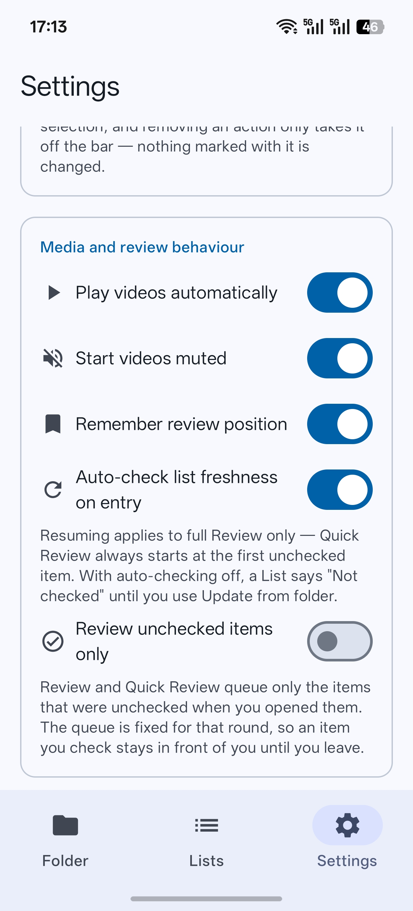

# Settings

Every switch and field on the Settings screen, what it changes, and where the full explanation
lives.

Settings are app-wide. A List's own webhook configuration is on that List's detail page, not here —
see [Webhooks](webhooks.md#the-two-configurations).

> **Every switch added after a feature shipped defaults to off**, so a fresh install and an
> untouched Settings page behave the same as they did before that feature existed.

- [Upstreams](#upstreams)
- [Review](#review)
- [Media and review behaviour](#media-and-review-behaviour)
- [Webhook](#webhook)
- [File management](#file-management)
- [Todo contents](#todo-contents)
- [Todo deletion](#todo-deletion)

## Upstreams

| Control | Default | What it does |
|---|---|---|
| **Each Upstream row** | — | Names one granted folder and what a walk of it finds: how many folders, how many files, and how much they take up. Counted the same way a List's scan counts, so the two can never disagree about what the folder holds. |
| **Add Upstream** | — | Opens Android's folder picker. The folder you choose becomes an Upstream. |

**This is where folders are added.** The Upstreams tab lists them and opens them, and offers no
picker of its own: adding a folder is not one of the things you do to a folder, and two places to
add one would be two places for the wording to drift apart.

**Adding a folder does not disturb the ones already there.** Each Upstream holds its own grant, and
a new one is registered beside them. Nothing is rebound, and nothing already registered is affected.

**Each row reports its own folder.** The counts under a row are that folder's, not one root's, which
is what makes several Upstreams readable side by side.

See [Core concepts → Folders you grant](core-concepts.md#folders-you-grant).

## Review

| Control | Default | What it does |
|---|---|---|
| **Enable Quick Review in Todo** | On | Off takes Quick Review out of a Todo, and stops the Upstreams browser showing which files are already checked. Presentation only — Lists keep their items, completion and actions. |
| **Custom action** *n* | Two configured | Each has a **display name** (the chip) and a **webhook value** (what payloads send). Add, rename, retag or remove freely. |
| **Add custom action** | — | Appends one, named from the first free slot. |

Removing an action takes it off the bar only: items already marked with it keep the mark, invisible
and unsent. Renaming changes future payloads and touches no stored item.

Full behaviour: [Review and actions → Custom actions](review-and-actions.md#custom-actions). What
the values do on the wire: [Webhooks → The payload](webhooks.md#the-payload).

## Media and review behaviour

  

| Control | Default | What it does |
|---|---|---|
| **Play videos automatically** | On | Whether a video starts playing when you arrive at it. |
| **Start videos muted** | Off | Whether a video arrives muted. A rule about *arriving*, not a mode — unmuting one video does not unmute the next. The transport's mute button overrides it for that file alone. |
| **Remember review position** | On | Whether full Review resumes where it left off. Quick Review always starts at the first unchecked item regardless. |
| **Auto-check list freshness on entry** | On | Whether opening a folder-backed List scans its source folder for changes. Off, a List reports *Not checked* until you use **Update from folder**, which still works either way. |
| **Review unchecked items only** | Off | Whether entering a review queues only the items that were unchecked at that moment. The queue is fixed for the round, so an item you check stays in front of you until you leave. |

*Remember review position* decides what is **read** on entry, never what is written — the position
keeps being recorded either way.

See [Review and actions](review-and-actions.md#video) for the video behaviour, and
[Rounds](review-and-actions.md#rounds) for what *unchecked items only* does to a queue.

## Webhook

| Control | Default | What it does |
|---|---|---|
| **Default enabled** | Off | Switches the app-default webhook on. |
| **Default URL** | Empty | The default endpoint. Copied into newly created Lists; existing Lists are never changed. Used directly by Quick Review and by **Resend**. |
| **Send from Quick Review** | Off | Whether finishing a Quick Review posts `quickreview.completed` through the default webhook. Needs *Default enabled* on and a URL filled in; anything missing is reported rather than passing silently. |
| **Send when leaving a review** | Off | Whether leaving a review posts `review.exited` for the round it covered. Review uses the List's own webhook; Quick Review uses the default one and also needs the switch above. |
| **Send checked items only** | Off | Narrows every payload — the test one included — to the items that are checked. |
| **Webhook history** | — | Every payload Listea has built, with its outcome. The line counts how many records there are and how many a receiver has still not accepted. |

A queue you finished on screen does not send twice on the way out, and a round with nothing in it is
reported instead of sent.

Full behaviour, the event table and the payload format: [Webhooks](webhooks.md).

## File management

| Control | Default | What it does |
|---|---|---|
| **Same filter and sort everywhere** | On | One filter and one sort order shared by every folder and every List. Off, each keeps its own. Switching discards nothing — both are kept either way. |
| **Ask to delete after webhook** | Off | After a webhook that **actually went out**, offers to delete the files that delivery carried as checked. |
| **Upstream** chips | First Upstream | Which folder the two rows below count and delete in. Shown only when more than one Upstream is registered; with one, there is nothing to choose. |
| **Checked files** | — | Counts every checked file under that folder that is still on the device. Not a List's progress and not a round's tally. |
| **Delete checked files** | — | Deletes all of them, permanently, after showing you the full named listing. |

## Todo contents

The two app-wide defaults a new Todo is created with. Both are also held per Todo, and a new Todo
takes these only at the moment it is created.

| Control | Default | What it does |
|---|---|---|
| **When a Task's content changes** | Keep it | The answer a new Todo starts with when a file it imported changes or disappears outside Listea. **Keep it** flags what has gone and changes nothing else; **Start it over** keeps the Task and clears its ticks, so moved content is judged again; **Replace the Task** deletes a Task that changed and mints a new one, taking it out of every List that held it. See [What a changed Task means](core-concepts.md#what-a-changed-task-means). |
| **Follow the upstream on new Todos** | Off | On, a new Todo is created following its upstream: opening it scans the folder and brings in material that appeared since, without asking. Off, opening a Todo never writes. |

**The three answers are written on the choice itself, not just its name**, and the third is the only
one that removes anything — which is why it is the third. A user setting it is stating an intention
about a Task they own, and that is the whole of its licence: nothing in Listea infers this tier from
a Task's shape. See [Task lifetime](core-concepts.md#task-lifetime).

Both defaults follow the rule at the top of this page, and both are the behaviour-preserving answer.
Before this release a re-import changed no Task's state, and no run ever started by itself; a Todo
that arrived already starting Tasks over would have begun clearing judgments the user never asked it
to touch.

## Todo deletion

**Not on the Settings screen**, and recorded here because it is a default and this is where defaults
are written down. It sits in the delete confirmation instead, where its consequence is legible at
the moment it is being decided, and it is stored per Todo rather than app-wide.

| Control | Default | What it does |
|---|---|---|
| **Keep the decisions** | Off | Whether dissolving a Todo writes down what its Tasks were judged to be — including, for Tasks nobody judged, the fact that nobody had. On, a Todo **created** at the same folder is later offered that record to load from; off, the decisions go with the Tasks. See [Deleting a Todo](core-concepts.md#deleting-a-todo). |

Off follows the rule at the top of this page, and it is the sharper case for it: before v0.4.0
nothing could delete a Todo at all, so a Todo that arrived already keeping a record would have begun
doing something the user never asked for. The switch is the only way this behaviour is reached —
nothing writes a record as a side effect of anything else.

## A Todo's own two policies

**Also not app-wide**, and for the same reason: both are statements about one Todo, so both live on
that Todo rather than here. They are the two switches in the Todo card's overflow menu, above
**Delete Todo…**, and the app-wide settings above are only what a *new* Todo is seeded with.

| Control | Default | What it does |
|---|---|---|
| **Follow the upstream** | Off | This Todo alone: opening it syncs material that appeared since, without asking. |
| **Keep decisions when deleted** | Off | This Todo alone: dissolving it writes down what its Tasks were judged to be, for a later Todo at the same folder to load back. |

**Both write the same columns the two app-wide defaults seed**, which is what makes a Todo's card
the place its own behaviour is decided: a Todo made before either control existed has the settings
its row was backfilled with, and changing the app-wide default afterwards leaves it where it is.

The Todo holds a **third** standing answer — *When a Task's content changes* — and the card
**reports it without offering it**. It is printed under the Todo's name, in the words and under the
heading the Create Tasks dialog asked the question with, so a Todo under **Replace the Task** is
visibly not one under **Keep it** before the run that would tell you. Changing it stays in the
dialog, because that is where its three consequences are spelled out and a one-line switch cannot
carry them. Earlier drafts left the card silent on the grounds that the tier is a word about a run;
the cost of that is a Todo whose next import will delete a Task looking exactly like one that will
not.

Each row prints its consequence under its name, because neither switch shows one when it is thrown:
following the upstream writes on a later day without being asked, and keeping decisions on delete
only matters at a delete that has not happened yet. The row is the target rather than the thumb, and
tapping one leaves the menu open — a policy is set without the menu closing, so both can be read and
changed in one visit.

Filtering and sorting only change what is shown, and which items a review then walks. Progress,
completion and webhooks always count the whole folder or the whole List.

> **Two different scopes, deliberately.** *Ask to delete after webhook* offers exactly the checked
> items in the payload that just went out. *Delete checked files* covers every checked file under
> the chosen Upstream, however and whenever it was checked. The dialogs say which one you are
> looking at.

Full behaviour, including write access and what happens to deleted files' decisions:
[File management](file-management.md). The filter and sort options themselves:
[Review and actions → Filtering and sorting](review-and-actions.md#filtering-and-sorting).

---

Next: [File management](file-management.md) for the destructive settings in full, or
[Webhooks](webhooks.md) for the delivery ones.
